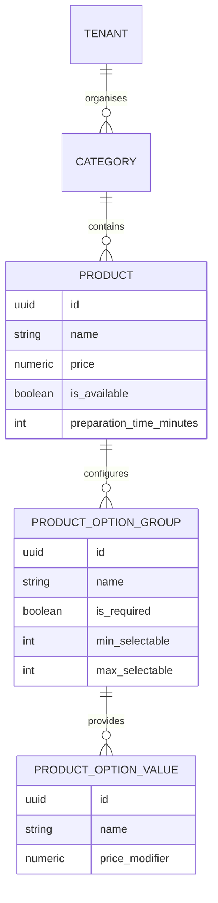

# 25 — CATÁLOGO DE PRODUCTOS, VARIANTES Y MODIFICADORES
## Modelo de Datos de Catálogo, Agrupación de Modificadores y Protección de Precios

---

## 1. ESTRUCTURA DEL CATÁLOGO GASTRONÓMICO

Un catálogo para food trucks difiere del e-commerce tradicional en que casi cualquier plato admite personalización: término de cocción de la carne, tipo de pan, adición de bacon o eliminación de cebolla.

---

## 2. VALIDACIÓN DEL LADO DEL SERVIDOR

El precio final de un plato configurado con extras jamás se calcula exclusivamente en el frontend.

En [`src/features/orders/actions.ts`](../src/features/orders/actions.ts):
1. El servidor recibe los IDs de las opciones seleccionadas.
2. Consulta los precios oficiales en `product_option_values`.
3. Suma el precio base del producto más cada modificador verificado.
4. Genera una instantánea inmutable en formato JSONB dentro de `order_items.options_snapshot`.
