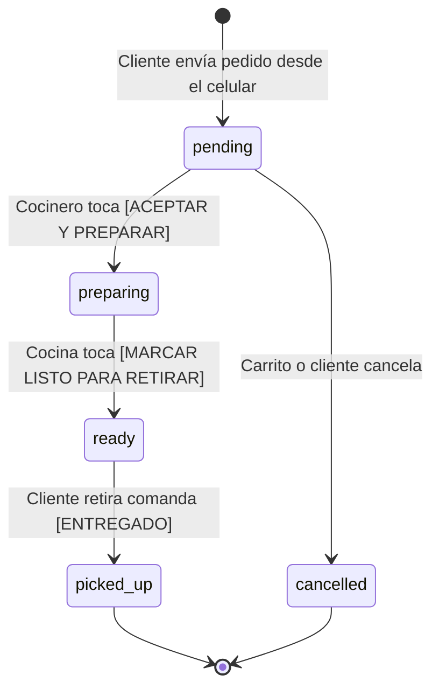

# 28 — PEDIDOS, CHECKOUT Y MÁQUINA DE ESTADOS
## Ciclo de Vida, Snapshots Inmutables y Recálculo de Precios en Servidor

---

## 1. EL CICLO DE VIDA DE UN PEDIDO EN CARRITO TAKE-AWAY

En un carrito de comida, la velocidad de despacho es crítica. Un pedido atraviesa una máquina de estados estricta:



### Transiciones válidas y prohibidas:
* **Prohibido saltar de `pending` a `picked_up`:** Garantiza que la comanda pase obligatoriamente por la pantalla de preparación.
* **Prohibido reabrir un pedido `cancelled`:** Si un pedido se canceló, debe crearse una nueva comanda para evitar descalces en stock e insumos.

---

## 2. SEPARACIÓN: `ORDER_STATUS` VS. `PAYMENT_STATUS`

Un error común de principiante es tener un único campo `estado = 'pagado'` o `'pendiente'`.

En gastronomía real, un pedido puede estar en preparación mientras su pago está pendiente (ejemplo: **Efectivo al retirar** o **Transferencia bancaria en mostrador**). Por eso coexisten dos dimensiones ortogonales:

| `order_status` | `payment_status` | Significado Operativo |
| :--- | :--- | :--- |
| `pending` | `cash_on_pickup` | Nuevo pedido; el cliente pagará en mano al retirar. |
| `preparing` | `approved` | Pagado online por Mercado Pago y cocinándose. |
| `ready` | `cash_on_pickup` | ¡Listo para retirar! El staff debe cobrar antes de entregar. |
| `picked_up` | `approved` | Pedido entregado y abonado satisfactoriamente. |

---

## 3. SEGURIDAD FINANCIERA: RECÁLCULO OBLIGATORIO EN SERVIDOR

> ⚠️ **REGLA DE ORO DE COMERCIO ELECTRÓNICO:**  
> **"NUNCA confíes en los precios ni en el total monetario que envía el navegador."**

Si la Server Action aceptara un payload como `{ total: 200 }`, un usuario técnico podría modificar el código JavaScript con DevTools y comprar 10 hamburguesas triples por $200.

En [`src/features/orders/actions.ts`](../src/features/orders/actions.ts), el cliente solo envía IDs de productos, cantidades y IDs de opciones seleccionadas:
1. El servidor busca cada producto en la tabla `products` con su precio real de base de datos.
2. El servidor busca cada adicional en la tabla `product_options`.
3. El servidor suma matemáticamente los subtotales:
   $$\text{Subtotal} = \sum (\text{Precio Base} + \sum \text{Precios Opciones}) \times \text{Cantidad}$$
4. Cualquier valor enviado por el cliente es descartado; solo vale el cálculo del servidor.

---

## 4. SNAPSHOTS INMUTABLES EN `ORDER_ITEMS`

Los datos de un pedido son un **documento histórico legal y contable**.

Si hoy vendés una hamburguesa a **$8.000**, y el mes que viene la aumentás a **$10.000**:
* Los reportes de facturación de hoy deben seguir mostrando **$8.000**.
* Si modificás los ingredientes o eliminás el producto del menú, el comensal debe seguir viendo exactamente lo que compró en su comprobante.

Por ello, la tabla `order_items` guarda una copia estricta (snapshot) en el instante de la venta:
```sql
create table order_items (
  product_name text not null,        -- 'Doble Cheese Bacon'
  unit_price numeric(12,2) not null, -- 8000.00
  quantity integer not null,         -- 2
  subtotal numeric(12,2) not null,   -- 16000.00
  options_snapshot jsonb not null    -- [{"name": "Panceta extra", "extraPrice": 1500}]
);
```

---

## 5. CRM PROGRESIVO: CLIENTES SIN FRICCIÓN

Para evitar la deserción en la compra, el cliente no crea contraseña.
1. Ingresa su **Nombre** y **Teléfono/WhatsApp**.
2. El sistema busca en la tabla `customers` del tenant:
   * Si el teléfono ya existe: actualiza `total_orders = total_orders + 1` y acumula el gasto.
   * Si es la primera vez: inserta un nuevo registro de cliente.
3. El carrito construye así una base de datos de clientes y recurrencia sin haber obligado a un registro tedioso.
