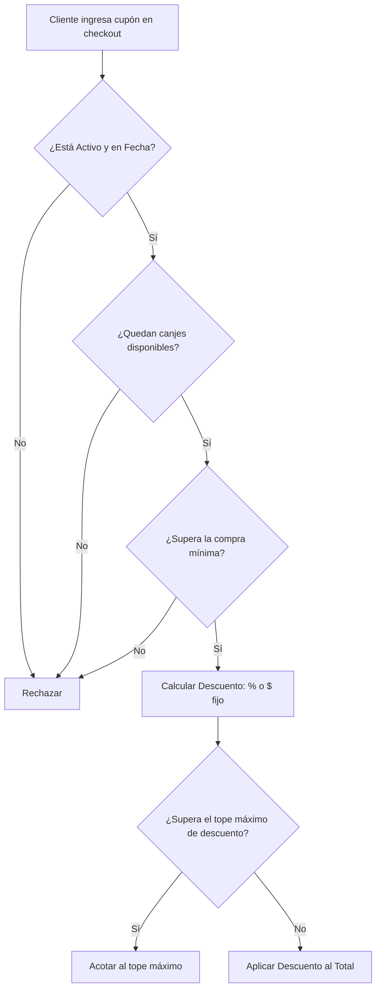

# 29 — CUPONES DE DESCUENTO Y REGLAS DE NEGOCIO
## Arquitectura de Promociones, Protección de Margen y Doble Validación

---

## 1. TIPOS DE CUPONES Y PROTECCIÓN DE MÁRGENES

En gastronomía, los márgenes de ganancia suelen rondar entre el 20% y el 35%. Un cupón mal configurado puede hacer que el food truck pierda dinero en cada venta.

Por ello, la entidad `coupons` implementa 4 candados de seguridad financiera:

### Campos de Protección Financiera:
1. `min_order_amount`: Evita que usen un cupón de $2.000 en una gaseosa de $1.500.
2. `max_discount_amount`: En cupones del 50% OFF, limita el descuento a un valor tope (ej: hasta $5.000).
3. `max_uses`: Limita la campaña a los primeros N comensales (ej: 50 cupones de inauguración).
4. `valid_until`: Define el fin de la campaña promocional.

---

## 2. DOBLE VALIDACIÓN: CLIENTE VS. SERVIDOR

La validación de cupones se ejecuta en dos momentos distintos:

### Momento 1: Vista Previa en Cliente (`validateCouponAction`)
Cuando el comensal escribe `BURGER15` y toca `[Aplicar]` en [`CartDrawer.tsx`](../src/features/orders/components/CartDrawer.tsx):
* Se consulta al servidor de forma liviana.
* Si es válido, la interfaz tacha el precio anterior y muestra el nuevo total verde brillante, mejorando la conversión de compra.

### Momento 2: Recálculo Estricto en Servidor (`createOrderAction`)
Cuando el cliente presiona `[Enviar Pedido]`:
* **El servidor NUNCA confía en el descuento enviado por el navegador.**
* Vuelve a consultar la tabla `coupons` con bloqueo transaccional.
* Comprueba nuevamente la fecha, los usos restantes y la compra mínima.
* Incrementa `current_uses = current_uses + 1`.
* Si el cupón se agotó en ese segundo, la orden se rechaza o recalcula limpiamente.
