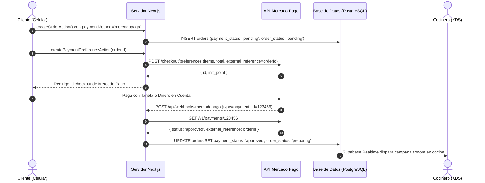

# 30 — INTEGRACIÓN DE PAGOS CON MERCADO PAGO
## Checkout Pro, Preferencias de Pago, Webhooks Idempotentes y Reconciliación

---

## 1. MODELO DE PAGOS EN CARRITO TAKE-AWAY

En un SaaS multi-tenant gastronómico, la recaudación no puede centralizarse en una sola cuenta bancaria porque generaría problemas impositivos y de dispersión de fondos.

Por ello, **cada food truck cobra en su propia cuenta de Mercado Pago**:
* El dueño ingresa su `Access Token` y `Public Key` en `/admin/[tenantSlug]/settings/payments`.
* Los cobros se liquidan directamente en su cuenta bancaria o billetera virtual de Mercado Pago.
* La plataforma opera de forma desacoplada y sin custodiar los fondos de las comidas.

---

## 2. CICLO DE VIDA DE UN PAGO ONLINE



---

## 3. IDEMPOTENCIA Y SEGURIDAD EN EL WEBHOOK

> ⚠️ **REGLA FUNDAMENTAL DE WEBHOOKS:**  
> Mercado Pago reintenta enviar la notificación si la red falla o la respuesta tarda más de 3 segundos.  
> Un webhook **NUNCA** debe procesar dos veces el mismo pago.

En [`src/app/api/webhooks/mercadopago/route.ts`](../src/app/api/webhooks/mercadopago/route.ts):

1. **Chequeo de Idempotencia:**
   ```typescript
   if (order.payment_status === 'approved') {
     return NextResponse.json({ status: 'already_approved' }, { status: 200 });
   }
   ```
2. **Entrada Directa a Cocina:**  
   Cuando el pago pasa a `approved`, la orden se transiciona automáticamente de `pending` a `preparing`. La comanda salta directo a la plancha sin que el cocinero tenga que dudar si el comensal pagó o no.
3. **Respuesta Rápida HTTP 200:**  
   Siempre se devuelve `HTTP 200 OK` para confirmar la recepción y evitar ráfagas de reintentos innecesarios.

---

## 4. SOPORTE DE ENTORNO SANDBOX VS. PRODUCCIÓN

Para permitir que los desarrolladores y los dueños de los carritos prueben el flujo completo sin debitar dinero real de sus tarjetas de crédito:
* Un switch en pantalla permite alternar entre **Modo Sandbox** y **Modo Producción**.
* Si el carrito aún no vinculó credenciales reales, el sistema genera automáticamente un enlace de pago simulado que permite testear el flujo de aprobación instantáneamente.
