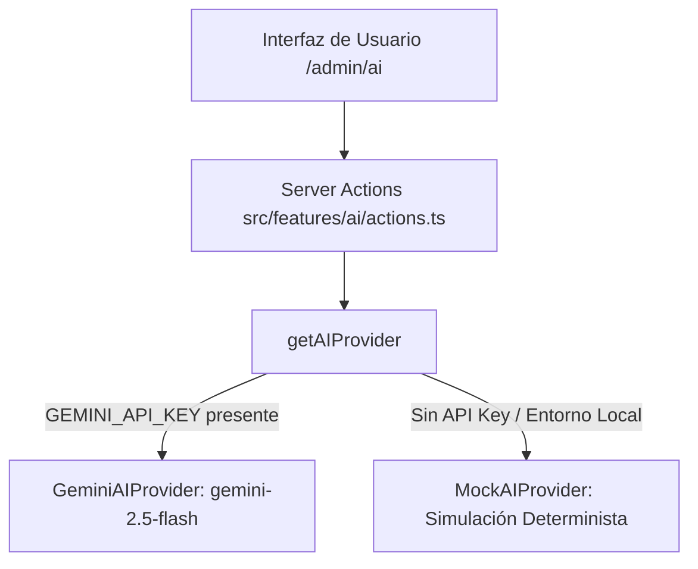

# 32 — MÓDULO DE IA GASTRONÓMICA DESACOPLADO
## Visión Multimodal OCR, Redacción Apetitosa y Cartelería QR

---

## 1. PRINCIPIO DE DISEÑO: ARQUITECTURA DESACOPLADA DE PROVEEDORES

El error más grave al construir funcionalidades de Inteligencia Artificial en un SaaS es importar librerías propietarias (`@google/generative-ai`, `openai`) directamente en los componentes de interfaz o Server Actions.

Si el proveedor cambia sus contratos, sus precios o sufre caídas de servicio, toda la plataforma queda comprometida.

En **Carrito Take-Away**, la IA opera detrás de un contrato TypeScript inmutable:

```typescript
export interface AIProvider {
  extractMenuFromImage(imageBase64: string): Promise<ParsedMenuResult>;
  generateProductDescription(productName: string, categoryName?: string, ingredients?: string): Promise<string[]>;
  generateMarketingCopy(businessName: string, specialty: string, tone: 'fun' | 'serious' | 'promotional'): Promise<MarketingCopyResult>;
}
```



---

## 2. OCR DE MENÚS FÍSICOS Y DIGITALIZACIÓN EN 1 CLIC

Muchos dueños de food trucks tienen sus cartas escritas a tiza en pizarras de madera o impresas en volantes plastificados. Cargar 40 productos a mano suele ser la principal barrera de adopción del SaaS.

### Flujo de Visión Multimodal:
1. El usuario toma una fotografía con la cámara de su celular.
2. La imagen viaja en Base64 directamente al Server Action `extractMenuFromImageAction`.
3. El modelo de visión analiza la tipografía y los precios y devuelve un esquema estructurado:
   ```json
   {
     "categories": [
       {
         "name": "Hamburguesas Especiales",
         "products": [
           {
             "name": "Burger Smash Criolla",
             "description": "Medallón con provoleta y chimichurri",
             "price": 8400,
             "categoryName": "Hamburguesas Especiales"
           }
         ]
       }
     ]
   }
   ```
4. El usuario revisa los platos en pantalla y presiona `[Guardar en mi Carta]`.
5. `importParsedMenuAction` valida los límites de productos del plan (`canCreateProduct`) y crea las categorías e ítems en PostgreSQL sin fricción.

---

## 3. GUARDARRAÍLES Y MONETIZACIÓN

Las llamadas a modelos de IA consumen cómputo y dinero. Por ello, el módulo está estrictamente monetizado a través del motor de Entitlements:

```typescript
// Validación antes de consumir la API
const isAllowed = await hasFeature(tenantId, 'ai_menu_import');
if (!isAllowed) {
  return {
    success: false,
    error: 'El Escaneo de Menú con IA está disponible en los planes Pro y Premium.',
  };
}
```

Esto transforma la IA en un potente motor de conversión para impulsar upgrades del Plan Básico al Plan Pro.
