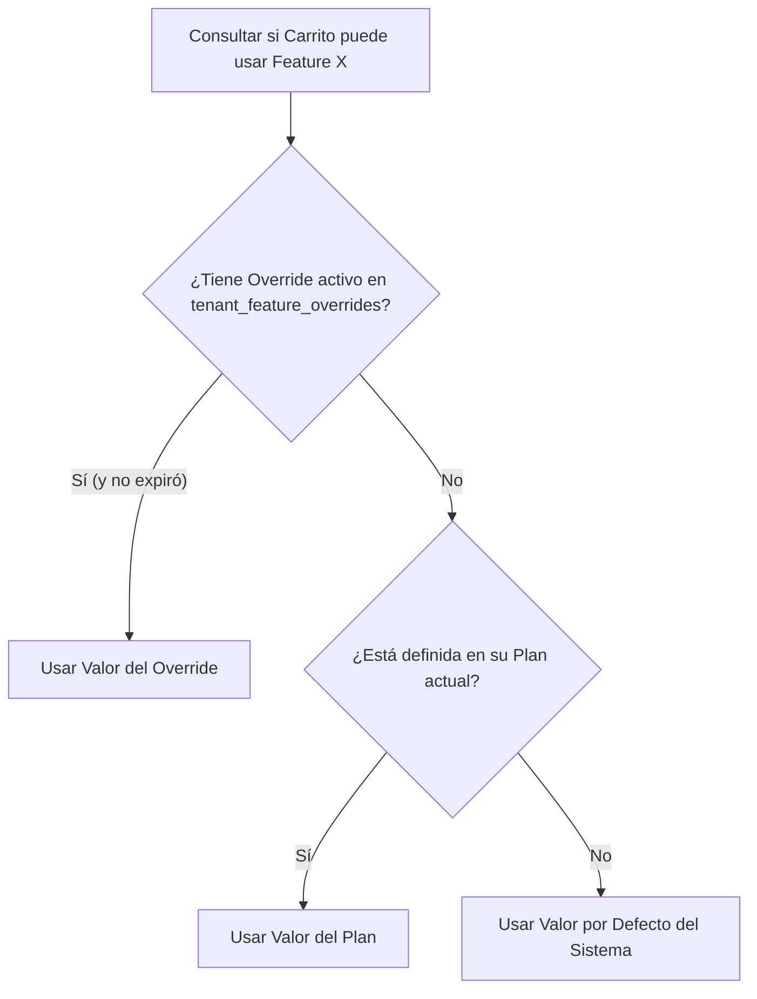

# 35 — SUSCRIPCIONES, PLANES Y FEATURE OVERRIDES
## Ciclo de Vida de Planes, Entitlements y Excepciones Comerciales

---

## 1. LOS PLANES DEL SAAS Y SU JERARQUÍA

El modelo comercial de **Carrito Take-Away** estructura los ingresos mediante tres planes preconfigurados:

| Plan | Código | Precio Mensual | Límites y Capacidades |
| :--- | :--- | :--- | :--- |
| **Básico** | `basic` | $9.900 ARS | Hasta 20 productos, carta digital, KDS estándar. |
| **Pro** | `pro` | $24.900 ARS | Hasta 80 productos, sonido KDS Web Audio, temas personalizados y cupones. |
| **Premium** | `premium` | $49.900 ARS | Productos ilimitados, IA gastronómica, soporte prioritario y multi-sucursal. |

---

## 2. LA REGLA DE ORO: `OVERRIDE > PLAN > DEFAULT`

El error más común en arquitectura SaaS es crear planes especiales para clientes particulares ("Plan Amigo", "Plan Evento Especial"). Esto contamina la base de datos con decenas de planes duplicados.

En nuestro motor de Entitlements ([`src/features/billing/entitlements.ts`](../src/features/billing/entitlements.ts)), la resolución de una característica sigue una cascada estricta:

### Casos Reales de Overrides:
* **Promoción por Inauguración:** Conceder 9.999 productos a un carrito con plan Básico durante sus primeros 3 meses de vida (`expires_at = now() + 90 days`).
* **Beta Testers de IA:** Habilitar el módulo de IA gastronómica a 5 food trucks seleccionados antes del lanzamiento masivo.

---

## 3. CÁLCULO DE MRR (MONTHLY RECURRING REVENUE)

En el dashboard de Super Admin ([`src/app/admin/super/page.tsx`](../src/app/admin/super/page.tsx)), el MRR se calcula en tiempo real agregando las suscripciones activas:

$$\text{MRR} = \sum_{t \in \text{Tenants Activos}} \text{Precio}(\text{Plan}_t)$$

Esto proporciona visibilidad inmediata sobre la salud financiera del SaaS, permitiendo proyectar el crecimiento sin necesidad de herramientas externas de analítica.
