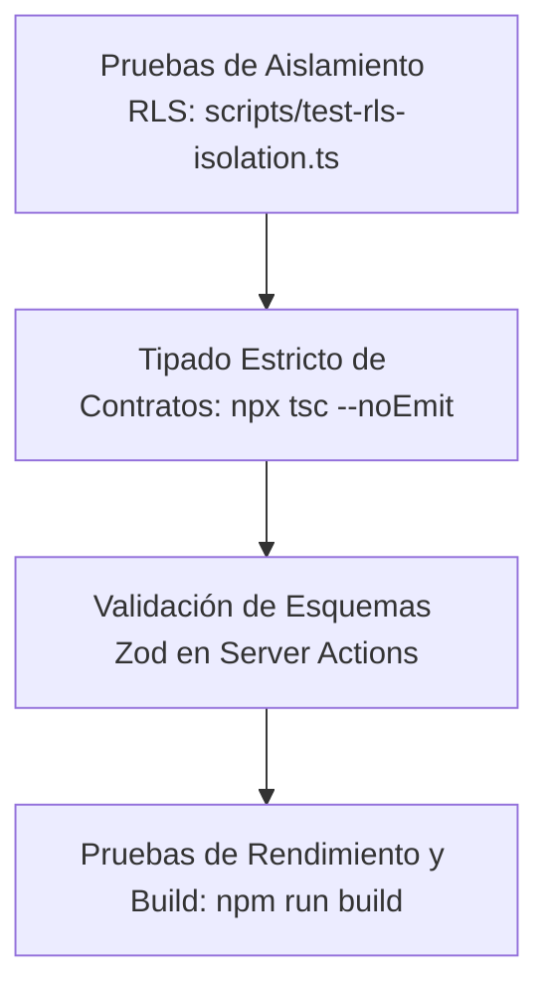

# 39 — ESTRATEGIA DE TESTING, QA Y VALIDACIÓN RLS
## Pruebas de Aislamiento de Datos, Mutaciones Concurrente y Calidad de Código

---

## 1. PIRÁMIDE DE TESTING EN SAAS MULTI-TENANT

En una plataforma multi-tenant, la prioridad número uno del testing no es la cobertura de líneas de código arbitraria, sino **garantizar que jamás ocurra una fuga de datos entre inquilinos (Cross-Tenant Data Leak)**.



---

## 2. EJECUCIÓN DE PRUEBAS DE SEGURIDAD

Para auditar el aislamiento de la base de datos se utiliza el script automatizado:

```bash
npx tsx scripts/test-rls-isolation.ts
```

Este script ejecuta tres vectores de ataque simulados:
1. Intento de lectura anónima de pedidos ajenos (bloqueado por RLS).
2. Inserción de productos sin membresía activa en el tenant (rechazado por base de datos).
3. Modificación de configuraciones de cobro de otro carrito (bloqueado por jerarquía de roles).
